

<a href="https://azterisk.net"></a><a href="https://github.com/Azteriisk"></a><a href="https://x.com"></a><a href="https://discord.com"></a><a href="https://www.linkedin.com"></a>
<a href="https://github.com/Azteriisk/UnknownFouriers"></a><a href="https://github.com/Azteriisk/SpectralSubtractor"></a>
<a href="https://github.com/Azteriisk/omarchy-display-manager"></a><a href="https://github.com/Azteriisk/omarchy-boot-manager"></a>

Console design and contribution city concept by <a href="https://github.com/georgekobaidze/georgekobaidze">Giorgi Kobaidze</a>, used under MIT.

